<picture>
  <source media="(prefers-color-scheme: dark)" srcset="./dark.svg">
  <source media="(prefers-color-scheme: light)" srcset="./light.svg">
  
</picture>

## Hi, I'm Ahad 👋

I'm a Computer Science student at **FAST NUCES (Class of 2028)**, interested in building practical AI applications and exploring the intersection of **Generative AI and cybersecurity**.

I enjoy taking ideas from prototype to deployment, learning by building, and solving practical problems with software and machine learning.

### Focus areas
- **AI / ML:** Python, scikit-learn, data preprocessing, predictive modeling
- **Generative AI:** RAG, agentic AI, LLM applications, LangChain, FastAPI
- **AI Security:** secure AI applications and LLM security
- **Blue Team / SOC:** Elastic Stack, Kibana, Sysmon, SIEM, network analysis, threat detection, incident response

### Featured projects
- **[Talafuz AI](https://lnkd.in/dQwJb63u)** — AI-powered subtitle generation and editing for multilingual South Asian content, including Urdu, Roman Urdu, Hindi, and English.
- **[Urban Sense AI](https://usamap.netlify.app/)** — Machine-learning-based accident-risk prediction project.
- **Clinical Risk Assessment** — Multi-model risk assessment for heart disease, diabetes, and hypertension using scikit-learn.
- **House Price Prediction** — Machine-learning project using property data for Karachi.

### Tools & technologies
`Python` `FastAPI` `LangChain` `scikit-learn` `Flask` `React` `pandas` `NumPy` `Git`  
`Elasticsearch` `Kibana` `Sysmon` `Wireshark` `Wazuh` `Snort` `Suricata` `Linux`

### Connect
- **GitHub:** [@ahadxdev](https://github.com/ahadxdev)
- **LinkedIn:** [Abdul Ahad Memon](https://www.linkedin.com/in/abdul-ahad-memon-b27801332/)

---
*Currently open to AI/ML, Generative AI, AI Engineering, and AI Security internship opportunities.*
